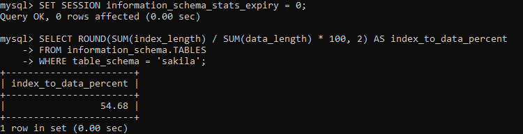
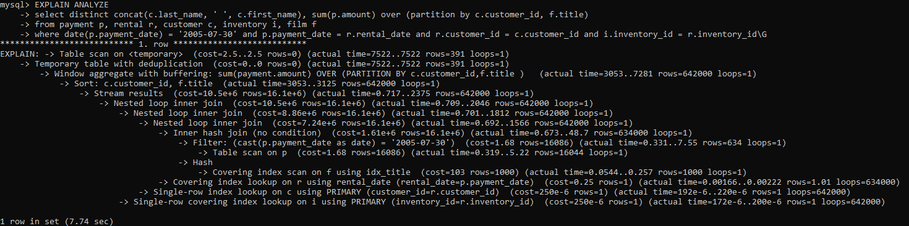
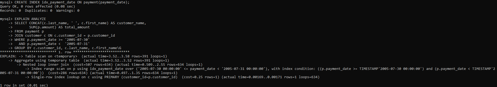
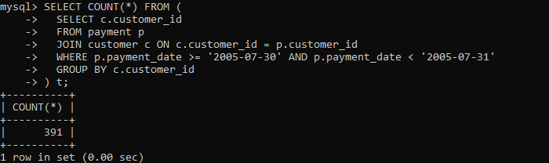

# Домашнее задание к занятию «Индексы»


Все запросы выполнены в базе данных `sakila` (MySQL 8.4).

---

## Задание 1

Напишите запрос к учебной базе данных, который вернёт процентное отношение общего размера всех индексов к общему размеру всех таблиц.

```sql
SET SESSION information_schema_stats_expiry = 0;

SELECT ROUND(SUM(index_length) / SUM(data_length) * 100, 2) AS index_to_data_percent
FROM information_schema.TABLES
WHERE table_schema = 'sakila';
```

- `data_length` — размер данных таблиц (в InnoDB сюда входит и первичный ключ, так как данные хранятся в кластерном индексе);
- `index_length` — размер вторичных индексов;
- `information_schema_stats_expiry = 0` отключает кэширование статистики, чтобы размеры были актуальными.

**Результат:** 54.68 %.



---

## Задание 2

Выполните `EXPLAIN ANALYZE` следующего запроса:

```sql
select distinct concat(c.last_name, ' ', c.first_name), sum(p.amount) over (partition by c.customer_id, f.title)
from payment p, rental r, customer c, inventory i, film f
where date(p.payment_date) = '2005-07-30' and p.payment_date = r.rental_date and r.customer_id = c.customer_id and i.inventory_id = r.inventory_id
```

- перечислите узкие места;
- оптимизируйте запрос: внесите корректировки по использованию операторов, при необходимости добавьте индексы.

### EXPLAIN ANALYZE исходного запроса

Время выполнения — **7.74 сек**, результат — 391 строка.



### Узкие места

1. **Декартово произведение с таблицей `film`.** Для `film` не задано условие соединения (`f.film_id = i.film_id`), поэтому в плане появляется `Inner hash join (no condition)`: 634 платежа умножаются на 1000 фильмов — **634 000 строк**.
2. **Лишние таблицы.** `film`, `inventory` и `rental` не нужны для результата (ФИО покупателя и сумма платежей), но участвуют в соединениях: 642 000 обращений к индексам `rental`, `customer`, `inventory` (`loops=642000`).
3. **Функция над индексируемым полем.** Условие `date(p.payment_date) = '2005-07-30'` превращается в `Filter: cast(p.payment_date as date)` и требует полного сканирования `payment` (`Table scan on p`, 16 044 строки ради 634 нужных).
4. **Нет индекса по `payment.payment_date`.**
5. **Оконная функция + `DISTINCT` вместо `GROUP BY`.** 642 000 строк сортируются (`Sort`, ~3 сек), обрабатываются оконной функцией (`Window aggregate`, ~4 сек), а затем дубликаты удаляются через временную таблицу (`Temporary table with deduplication`).
6. **Соединение `payment` и `rental` по дате** (`p.payment_date = r.rental_date`), хотя покупатель связан с платежом напрямую через `payment.customer_id`.
7. **Неявные соединения через запятую** затрудняют чтение запроса и позволяют пропустить условие соединения, как это произошло с `film`.

### Оптимизация

Добавлен индекс по дате платежа:

```sql
CREATE INDEX idx_payment_date ON payment(payment_date);
```

Оптимизированный запрос:

```sql
SELECT CONCAT(c.last_name, ' ', c.first_name) AS customer_name,
       SUM(p.amount) AS total_amount
FROM payment p
JOIN customer c ON c.customer_id = p.customer_id
WHERE p.payment_date >= '2005-07-30'
  AND p.payment_date <  '2005-07-31'
GROUP BY c.customer_id, c.last_name, c.first_name;
```

Что изменено:
- убраны лишние таблицы `rental`, `inventory`, `film` и вместе с ними декартово произведение;
- `date(payment_date) = ...` заменено на диапазон `>= '2005-07-30' AND < '2005-07-31'`, что позволяет использовать индекс;
- оконная функция с `DISTINCT` заменена на `GROUP BY`;
- соединения записаны явно через `JOIN`.

### EXPLAIN ANALYZE оптимизированного запроса

Используется `Index range scan on p using idx_payment_date` — читаются только 634 строки за нужную дату. Время выполнения — **3.58 мс**.



### Проверка результата

Оптимизированный запрос возвращает те же **391 строку**, что и исходный.



### Итог

| | Исходный запрос | Оптимизированный запрос |
|---|---|---|
| Время выполнения | 7.74 сек | 3.58 мс |
| Обработано строк (макс.) | 642 000 | 634 |
| Доступ к `payment` | Table scan | Index range scan |
| Строк в результате | 391 | 391 |
